# CUT&RUN: from sequencing reads to interpretable binding changes

**Draft status:** reconstructed from laboratory source code and saved logs. Analysis commands have not been executed in this milestone, and scientific validation is pending. Documentation checks are recorded in [validation](validation.md).

**Scientific review, 2026-10-30:** start with the [review summary](scientific-review.md), the expanded [20 decisions](decisions.md), and the [reference-aware spike audit](reference-audit.md). Confirmed documentation errors were corrected; unresolved scientific choices remain labeled and the original lab workers are unchanged.

The question is: **where is the antibody target enriched, and how does enrichment change between biological conditions?** CUT&RUN uses antibody-directed nuclease cleavage to release DNA associated with the target. Paired-end sequencing helps locate the released fragments. Signal can reflect both target occupancy and experimental recovery, so controls, fragment properties and normalization affect the interpretation. See the [original method](https://elifesciences.org/articles/21856).

This walkthrough reconstructs the selected lab workers, including their limitations. It follows reads through QC, trimming, combined-reference alignment, human selection, peak calling, coverage, replicate review, differential binding, motifs and figures. It also explains where historical branches differ.



[Open the diagram at full size](assets/workflow.svg) or edit its [Mermaid source](assets/workflow.mmd). Its main sequence is:

```text
Design + controls + reference identities
  → paired FASTQ → raw QC → trim → trimmed QC
  → align to human + yeast → MAPQ filter → sort/index
  → human BAM → narrow or target-reviewed broad peaks → blacklist review
      ├─ human BAM → CPM tracks → replicate QC → optional means
      ├─ combined BAM + approved spike reference/protocol → spike counts
      │     → spike-scaled tracks → replicate QC → optional means
      └─ per-replicate BAM + peaks + design → DiffBind counts
            → standard model; approved spike counts → spike model
            → contrast reports
            → coordinate-safe BED sets → motifs / annotations / MA plots
  → matched-scale browser tracks + fixed-region heatmaps → interpretation
```

Coverage tracks and peak CSV files answer different questions. Differential binding counts come from each replicate's BAM, not from averaged BigWigs. Browser averages illustrate conditions; they are not biological replicates.

## Work through the tutorial

| Read in order | What you will learn |
|---|---|
| [1. Design, inputs and read QC](01-design-and-reads.md) | Specify controls and replicates; recognize read-through adapters; preserve informative short reads |
| [2. Alignment, filtering and peaks](02-alignment-and-peaks.md) | Follow combined mapping, human extraction, narrow/broad decisions and blacklist handling |
| [3. Spike scaling and replicate QC](03-normalization-and-qc.md) | Audit spike counts, distinguish read segments from fragments, compare replicates and make tracks |
| [4. Differential binding and interpretation](04-differential-and-interpretation.md) | Reconstruct the two DiffBind branches, inspect contrasts, annotate peaks and create figures |

Start with [installation and references](installation.md) if the tools or genome resources are unfamiliar. Keep the [lab/external comparison](methods-comparison.md) and [decision log](decisions.md) beside the tutorial.

## How to read the evidence labels

- **L — observed lab practice:** directly supported by the [source registry](sources.md). This does not establish that every code path ran.
- **E — external method:** supported by a named primary method, official tool manual or the versioned nf-core implementation.
- **P — proposed improvement:** an explicit teaching or analysis change to assess; it is not represented as historical lab behavior.
- **U — unresolved:** evidence or scientific review is still required.

**Copy-ready scaffold** commands create only a generic teaching workspace or inspect synthetic values. **Configured examples** require real inputs, installed tools and reviewed reference paths. **Review-gated reconstructions** show observed commands with unresolved scientific or technical issues. Syntax checking never makes an analysis command scientifically validated.

No sequencing dataset is distributed with this draft. Names such as `control_A` and `treated_B` are fictional. Select an approved public or synthetic dataset and establish expected QC before an execution milestone. These chapters are a manual lesson; a future automation design is described in [next steps](next-steps.md).
